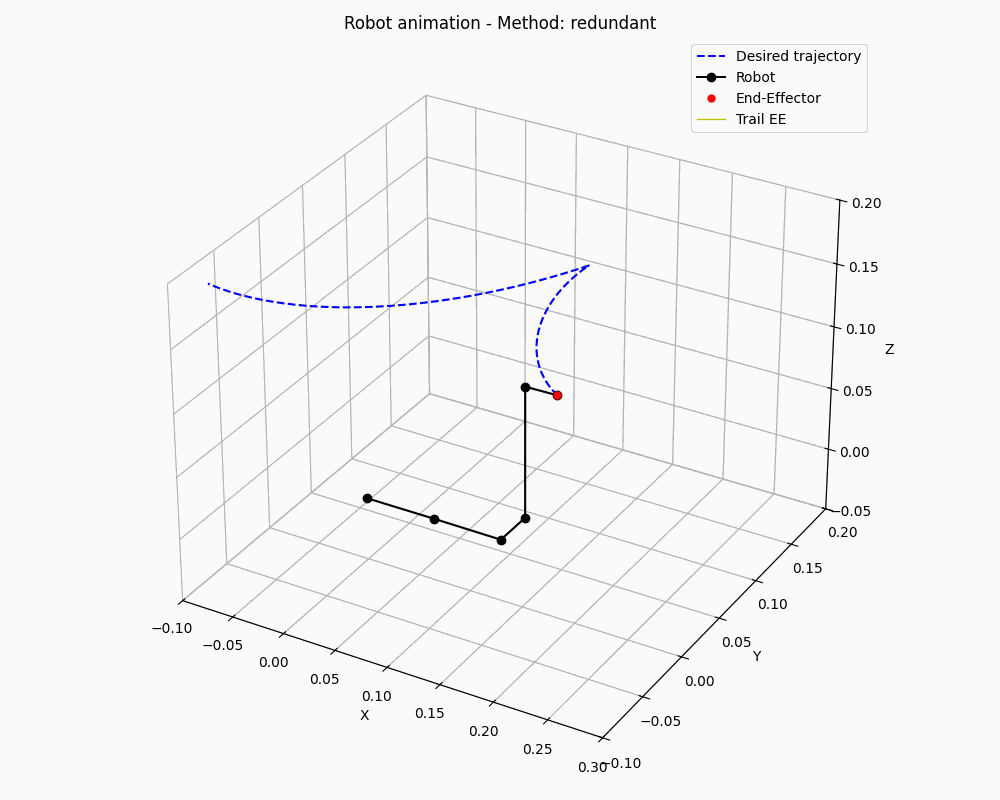
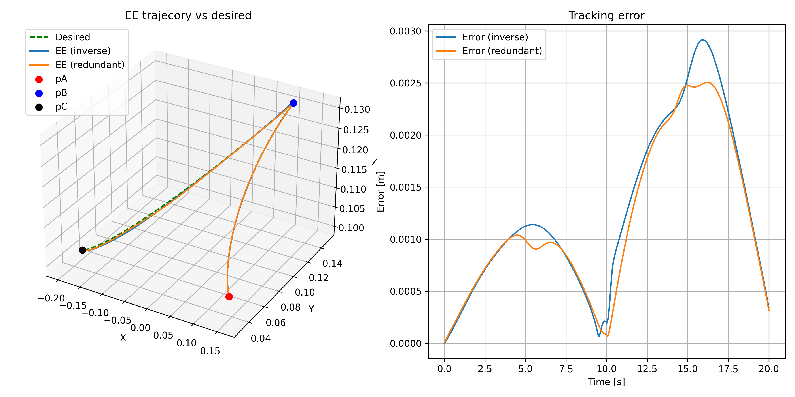

# 4-DOF Manipulator with LEGO Mindstorms EV3: Kinematics, Trajectory Planning and Redundancy Resolution

Final project for the **Industrial and Medical Robotics** course (*Robotica Industriale e Medica*), MSc in Biomedical Engineering, Università Campus Bio-Medico di Roma, A.Y. 2024/2025 (Mar–Jun 2025).

I built a **4-joint manipulator** with the LEGO Mindstorms EV3 kit. For it I modelled the kinematics and dynamics, planned a trajectory in operational space, simulated closed-loop inverse kinematics (CLIK) with redundancy resolution, and ran the controller on the real robot.

<p align="center">
  
</p>

---

## Pipeline

```
DH model → Forward kinematics → Workspace → Trajectory planning → Inverse kinematics (CLIK)
                                                                      ↳ redundancy: joint-limit functional
Dynamic model (B, C, G, friction) → Dynamic simulation      Real robot (EV3, Python ev3dev2)
```

### 1. Robot and kinematic model
- **Hardware:** EV3 brick, 2 Large Motors (joints 1–2) and 2 Medium Motors (joints 3–4), each with an incremental encoder.
- **Model:** Denavit–Hartenberg parameters for a 4-revolute-joint chain, with link lengths of 0.065, 0.065, 0.03 and 0.105 m.
- **Forward kinematics:** homogeneous transformation matrices from the base to the end-effector.
- **Jacobian:** the linear part of the geometric Jacobian (3×4). Only the end-effector position is controlled, so the arm has **1 degree of redundancy**.

### 2. Workspace
- The joint ranges, for example q₁ ∈ [0°, 175°] and q₂ ∈ [−14°, 106°], are sampled and every reachable end-effector point is stored (`Spazio_di_Lavoro_Medori.pkl`).
- The script checks that all the via points chosen for the trajectory are inside the workspace.

### 3. Trajectory planning
- The path goes A → B → C through **two circular arcs** in operational space. The centres are computed from the endpoints and a chosen radius.
- A **cubic polynomial timing law** along each arc keeps position and velocity continuous.

### 4. Inverse kinematics (CLIK)
Three algorithms are implemented:
- **Pseudo-inverse:** q̇ = J⁺ (ẋ_d + K e)
- **Jacobian transpose:** q̇ = Jᵀ (ẋ_d + K e)
- **Redundancy resolution:** q̇ = J⁺ (ẋ_d + K e) + kₐ (I − J⁺J) ∂w/∂q

In the third one, w(q) is a **joint-limit functional**: it keeps each joint as close as possible to the middle of its range. Its gradient is computed symbolically with SymPy and saved as a numerical function (`W_q_numpy_functions_fine_corsa.pkl`).

### 5. Dynamic model
Built symbolically in `Dinamica_Medori.ipynb`:
- Link and motor masses, centres of mass, and inertia tensors (links modelled as rectangular bodies, motors as cylinders).
- Inertia matrix **B(q)**, Coriolis matrix **C(q, q̇)** (Christoffel symbols), gravity vector **G(q)**, and viscous and Coulomb friction.
- Forward dynamics q̈ = B⁻¹(τ − Cq̇ − G − τ_friction), simulated with a **PD controller plus gravity compensation**.

### 6. Real robot
`Prova_Main.py` runs on the EV3 (ev3dev2). In each cycle it reads the real joint angles from the motor encoders, computes q̇ with the redundant CLIK, integrates the joint references, and sends position commands to the motors. Desired and measured joint angles are logged to `file_dati.txt`.

---

## Results

**Simulation:** both the pseudo-inverse and the redundant algorithm follow the planned trajectory closely. The tracking error stays below about **3 mm**, and redundancy resolution slightly lowers the peak error.

<p align="center">
  
</p>

Other plots in `results/`: the desired trajectory inside the workspace, end-effector position and velocity, joint variables with their limits, and how the functional w(q) evolves.

**Real robot:** the controller was integrated on the physical manipulator and the arm moved, but **it did not follow the desired trajectory** (see `results/video_real_manipulator.mp4`). Likely causes:
- the motors are commanded one at a time in blocking mode (`block=True`), so the joints don't move together;
- the LEGO links have backlash and flex;
- the timing between control cycles is irregular.

---

## Repository structure

```
├── code/
│   ├── spazio_di_lavoro_medori.ipynb       # DH model, forward kinematics, workspace
│   ├── funzionale_fine_corsa_medori.ipynb  # Joint-limit functional and its gradient (SymPy)
│   ├── ottimizz_funzionale_medori.ipynb    # Trajectory + inverse kinematics with redundancy
│   ├── simulazione_medori.py               # Full simulation: planning, CLIK, plots, animation
│   ├── Dinamica_Medori.ipynb               # Dynamic model and dynamic simulation
│   ├── Prova_Main.py                       # Controller for the real EV3 robot
│   ├── Plot_giunti_medori.ipynb            # Plots desired vs. measured joints from file_dati.txt
│   ├── *.pkl                               # Saved workspace and functional gradient
│   └── file_dati.txt                       # Log from the real robot
├── results/                                # Plots, animation and video of the real robot
└── docs/presentation.pptx                  # Final presentation (in Italian)
```

## How to run

- **Simulation:** from the `code/` folder, run `python simulazione_medori.py`. It needs `numpy`, `sympy`, `matplotlib` and `dill`, and loads the `.pkl` files from the same folder.
- **Real robot:** copy `Prova_Main.py` to an EV3 running **ev3dev** with motors on ports A–D, then run it with Python 3 and `ev3dev2`.

---

*Individual academic project developed at Università Campus Bio-Medico di Roma. Code comments and the presentation are in Italian.*
